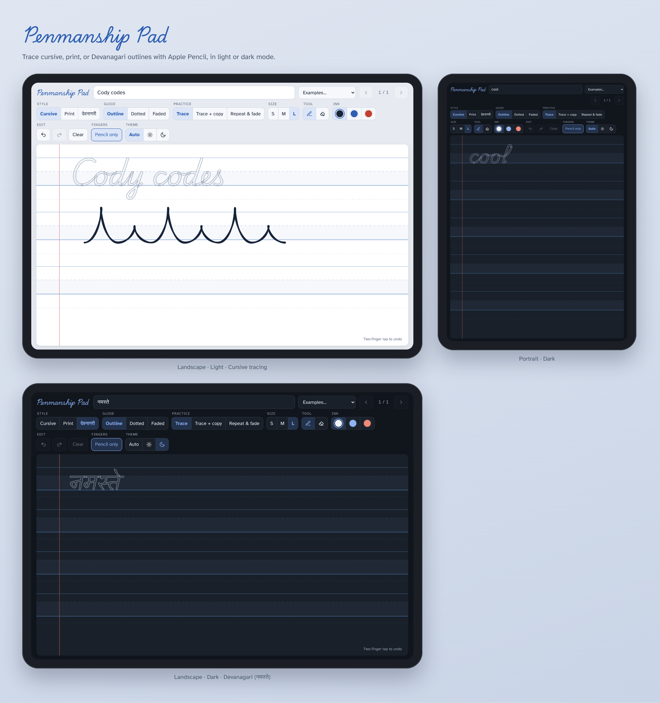

# Penmanship Pad

A single-file web app for practicing handwriting on iPad with Apple Pencil.

**Live site:** https://codycodes.github.io/Handwriting/ (after GitHub Pages is turned on, see below)

On iPad, open it in Safari, then tap **Share → Add to Home Screen** to use it full screen like an app.

## Features
- **Cursive** (Playwrite US Trad, a font made for teaching handwriting), **Print** (Andika), and **देवनागरी / Devanagari** (Kalam)
- Ruled lines: ascender line, dashed midline (the headline for Devanagari), baseline, descender line, and a red margin
- Tracing guides drawn as **Outline** (default), **Dotted**, or **Faded** letters
- Example words to start with: *Cody codes*, *cool*, *hello*, *coffee*, and more, plus alphabets and Devanagari (नमस्ते, कोडी कोड्स, consonants, vowels and numerals)
- **Theme:** Auto (follows iPad's setting), Light or Dark
- Practice layouts: Trace (default), Trace + copy, Repeat & fade
- Pressure-sensitive ink, eraser, undo/redo, clear, and 3 ink colors

## Apple Pencil handling
| Issue on iPad | What the app does |
| --- | --- |
| Palm touches the screen before the Pencil | When the Pencil is first detected, finger strokes from the last 2 seconds are removed (one undo restores them). After that, fingers never draw while **Pencil only** is on |
| Palm already drawing when the Pencil lands | The Pencil cancels the finger stroke and takes over |
| Palm resting on the toolbar presses buttons | Finger taps on the toolbar are ignored while the Pencil is writing or just lifted |
| Long press brings up the magnifier, text selection or callout menu | Turned off on the writing sheet |
| Pinch and double-tap zoom (Safari ignores `user-scalable=no`) | Blocked with `touch-action` and gesture event handling |
| Fast strokes look jagged | Uses coalesced pointer events where Safari provides them, plus curve smoothing |
| Pencil hover (M2 or later iPad Pro, Pencil Pro) | Shows a small ring where the tip will land |
| Two-finger tap | Undo |

These are limits of web apps that the app can't change:
- Double-tap and squeeze on the Pencil aren't available to websites.
- Swipes from the screen edges still open Control Center and the Home Screen. In Safari, **Add to Home Screen** gives you the most room.
- Scribble (handwriting into text fields) still works in the text box, which is handy for typing new practice text with the Pencil.

## GitHub Pages
`.github/workflows/pages.yml` deploys this repo to GitHub Pages on every push to `main`, or when you run it by hand from the Actions tab.

One-time setup: **Settings → Pages → Build and deployment → Source: GitHub Actions**.
